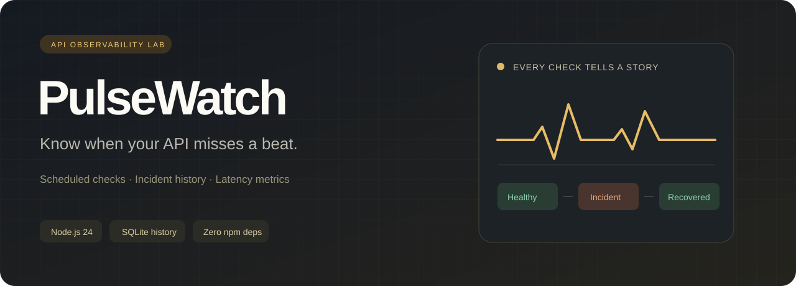

# PulseWatch



**Make an API fail. Watch the incident unfold. Understand the recovery.**

A local API reliability lab with a live dashboard, persistent SQLite history, a bounded HTTP-check queue, and deterministic failure scenarios. Everything runs on your machine with Node.js 24. No package installation, cloud account or API key is required.

## Start in under a minute

Install **Node.js 24.x**, open a terminal in this directory, then run:

```sh
node server.mjs
```

Open **http://127.0.0.1:4312** and select **Load demo services**. Stop with `Ctrl+C`.

```sh
node --test
```

`npm start` and `npm test` are optional aliases. There are no npm dependencies to install.

## What you can do

- Create, edit, pause, resume and remove HTTP/HTTPS monitors.
- Configure a GET endpoint, expected status, timeout and interval.
- Run one check or all enabled monitors immediately.
- Inspect the latest 60 samples as a latency timeline, including failed checks.
- Review observed success rate and successful-request p50/p95 latency.
- Follow incidents from the first failed check through the first recovery.
- Restart the app and retain your monitor configuration and measurement history.
- Explore healthy, slow and intermittently failing local demo endpoints.

The dashboard starts empty. Demo services are explicitly labelled, and every displayed sample comes from an actual HTTP request. No pre-generated production traffic, invented adoption statistics or seeded performance results are included.

## Three-minute demonstration

1. Select **Load demo services**. The storefront returns `200`. Inventory waits 600 ms, exceeding its 300 ms timeout. Checkout repeats `200 → 503 → 503 → 200`.
2. Observe the inventory incident. Run **Check all** several times to see checkout fail twice and then recover. Automatic checks also run every six seconds for demo monitors.
3. Edit **Demo / slow inventory** and raise its timeout to `1000` ms. The next check succeeds and resolves the open incident.
4. Pause a monitor. Its existing history remains visible; the scheduler stops requesting it. The manual check button still works.
5. Restart the app. The same stored history reappears; the demo checkout sequence resets when the process restarts.

The flaky sequence advances on every request, including manual requests to its endpoint. With automatic checks enabled, the exact visible sequence depends on when you press **Check all**.

## Measurement definitions

| Metric | Definition |
| --- | --- |
| Observed success rate | Successful checks / all retained checks × 100. This is a **sample fraction**, not a time-weighted availability SLA. |
| Successful check | Received HTTP status equals the monitor's configured expected status before its timeout. |
| p50 / p95 | Nearest-rank percentile of **successful** retained check durations only: sorted sample at `ceil(p × n) - 1`. |
| Measured latency | Time from starting the HTTP request to response headers and body cancellation; response bodies are not downloaded for analysis. |
| Empty latency set | Shown as `—`, including when every request has failed. |
| Incident duration | First observed failure to first observed recovery; open incidents use the current time. Actual outage boundaries may fall between samples. |
| Retention | Latest 500 checks and at most 100 incidents per monitor. The dashboard renders 60 samples and the latest 100 incidents across the workspace. |

HTTP redirects are recorded as their received 3xx status and **are not followed**. Paused services keep their previous status and incidents; pausing does not mark a failure as recovered. Changing the URL or expected status clears that monitor's checks/incidents because they belong to a different measurement series. Name, interval, enabled state and timeout edits preserve history.

## Architecture

```text
Browser dashboard ── same-origin JSON API ── Node HTTP server
                                                  │
                                    bounded deduplicating queue
                                       (3 concurrent requests)
                                                  │
                                          fetch + AbortController
                                                  │
                                       SQLite transaction
                                      checks + incident transition
```

| File | Responsibility |
| --- | --- |
| `server.mjs` | Local HTTP API, origin/host checks, fixed static-asset routes, demo endpoints, startup/shutdown |
| `src/runner.mjs` | Scheduling, timeout cancellation, concurrency limit, per-monitor request deduplication |
| `src/store.mjs` | Parameterized SQLite queries, retention and transactional incident transitions |
| `src/stats.mjs` | Pure sample aggregation and nearest-rank percentiles |
| `src/validation.mjs` | Configuration validation and structured client errors |
| `public/` | Responsive browser UI, no frontend build step |
| `test/` | Real HTTP integration tests and isolated queue/store/statistics tests |

The scheduler scans once per second. A service becomes due when its interval has elapsed since its most recent **completed** check. Queued or running requests for the same monitor share one promise. Slow requests therefore cannot pile up copies of themselves. A global queue limits concurrent checks to three.

Each result and its incident transition are committed in one transaction. A partial unique index permits only one unresolved incident per monitor. The first failure opens it, subsequent failures increment its counter, and the first success closes it. SQLite foreign keys cascade a monitor deletion to its local history.

The app discards an in-flight outcome if its target, expected status or timeout changed before completion. Shutdown stops scheduling, cancels pending work, aborts active requests and then closes the database.

## API examples

Create a monitor using a terminal:

```sh
curl -X POST http://127.0.0.1:4312/api/monitors \
  -H "Content-Type: application/json" \
  -d '{"name":"Example API","url":"http://127.0.0.1:8000/health","interval_ms":30000,"timeout_ms":1500,"expected_status":200}'
```

PowerShell equivalent:

```powershell
$body = @{ name = 'Example API'; url = 'http://127.0.0.1:8000/health'; interval_ms = 30000; timeout_ms = 1500 } | ConvertTo-Json
Invoke-RestMethod http://127.0.0.1:4312/api/monitors -Method Post -ContentType 'application/json' -Body $body
```

| Method | Route | Purpose |
| --- | --- | --- |
| GET | `/api/health` | Health check |
| GET | `/api/dashboard` | Monitors, summaries, recent samples and incidents |
| POST | `/api/monitors` | Create a monitor |
| PATCH | `/api/monitors/:id` | Change selected fields |
| DELETE | `/api/monitors/:id` | Remove a monitor and its history |
| POST | `/api/monitors/:id/run` | Wait for a manual check |
| POST | `/api/run-all` | Wait for all enabled monitors |
| POST | `/api/demo` | Add missing demo services and check enabled monitors |

## Configuration and local-use boundary

The server binds to `127.0.0.1`. `PORT` changes the port; `PULSEWATCH_DB` changes the SQLite file. Defaults are `4312` and `data/pulsewatch.sqlite`. Do not commit the generated `data/` directory.

PowerShell:

```powershell
$env:PORT = '4312'
$env:PULSEWATCH_DB = 'data/pulsewatch.sqlite'
node server.mjs
```

Limits: 20 monitors, 16 KiB JSON bodies, 100–10000 ms timeouts, 2–3600 second intervals, HTTP(S) URLs without embedded credentials. The response body is cancelled after receiving headers. The UI inserts user-controlled strings as text.

This is a **single-user local development tool**, not a public hosted monitoring service. It intentionally permits checks against localhost and private-network development APIs. There is no authentication or external target allowlist. Host and Origin checks reduce browser-driven cross-origin and DNS-rebinding exposure; they are not a substitute for authentication or a full SSRF control layer. Do not expose or reverse-proxy this app to a shared/public network. Monitor only endpoints you are authorized to test, and avoid secrets in URLs because URLs are stored in SQLite.

Design tradeoffs: synchronous SQLite keeps transactions straightforward at this small scale; the one-second scheduler is approximate; measurements are in-memory aggregation of bounded histories; there is no distributed worker, alert delivery, TLS certificate monitoring, body assertion, or production SLO reporting.

## Validation

The suite covers real local HTTP requests, timeouts, deterministic failure/recovery, CRUD, validation, Host/Origin boundaries, oversized payloads, static-path containment, queue concurrency, deduplication, fake-clock scheduling, configuration changes during requests, percentile definitions, retention, SQLite reopen and cascading deletion.

GitHub Actions runs `node --test` on Ubuntu and Windows with Node.js 24. The workflow is included; its remote status depends on execution after publishing.

Built with Node's [SQLite API](https://nodejs.org/docs/latest-v24.x/api/sqlite.html) and [test runner](https://nodejs.org/docs/latest-v24.x/api/test.html).

## По-русски: запуск и рассказ на собеседовании

**Что это:** локальная лаборатория мониторинга API. Она делает реальные HTTP-запросы, сохраняет результат в SQLite, открывает инцидент при ошибке и закрывает при восстановлении. Интерфейс показывает историю запросов, долю успешных проверок и p50/p95 успешных ответов.

**Запуск:** установи Node.js 24, открой терминал в папке проекта, выполни `node server.mjs`, перейди на `http://127.0.0.1:4312` и нажми **Load demo services**. Тесты: `node --test`. npm install не нужен.

**Что показать:** у `slow inventory` сначала timeout 300 мс при ответе за 600 мс. Измени timeout на 1000 мс: проверка станет успешной и инцидент закроется. У `flaky checkout` можно наблюдать последовательность `200, 503, 503, 200` и один инцидент на две ошибки подряд.

**Формулировка для резюме после изучения реализации:**

> Разработал учебную лабораторию мониторинга HTTP API на Node.js и SQLite: очередь с ограничением параллелизма и дедупликацией, таймауты, журнал инцидентов, статистика задержек и интеграционные тесты.

Этот проект — учебное портфолио. Не приписывай ему реальные продакшен-нагрузки, пользователей или гарантии доступности. Для разговора с работодателем важно уметь объяснить код и самостоятельно изменить поведение.

**Вопросы, которые стоит разобрать:**

1. Почему доля успешных проверок не равна точному uptime по времени?
2. Как очередь ограничивает параллелизм и не допускает двух одновременных проверок одного сервиса?
3. Зачем запись результата и обновление инцидента находятся в одной транзакции?
4. Почему p95 исключает неуспешные запросы и что показывается при отсутствии успешных ответов?
5. Что происходит при остановке процесса или редактировании монитора во время запроса?
6. Какие изменения нужны перед публичным хостингом: авторизация, изоляция сетевых запросов, секреты, ограничения частоты, асинхронная БД/воркеры?

**Идеи для собственного развития:** добавить jitter к расписанию; реализовать утверждения о JSON-теле ответа; экспортировать реальные измерения; внедрить таймеры с тестовым clock; вынести checker в отдельный процесс. Выбери одну задачу, реализуй её и рассказывай именно о своих решениях.

## License

MIT. See [LICENSE](LICENSE).
